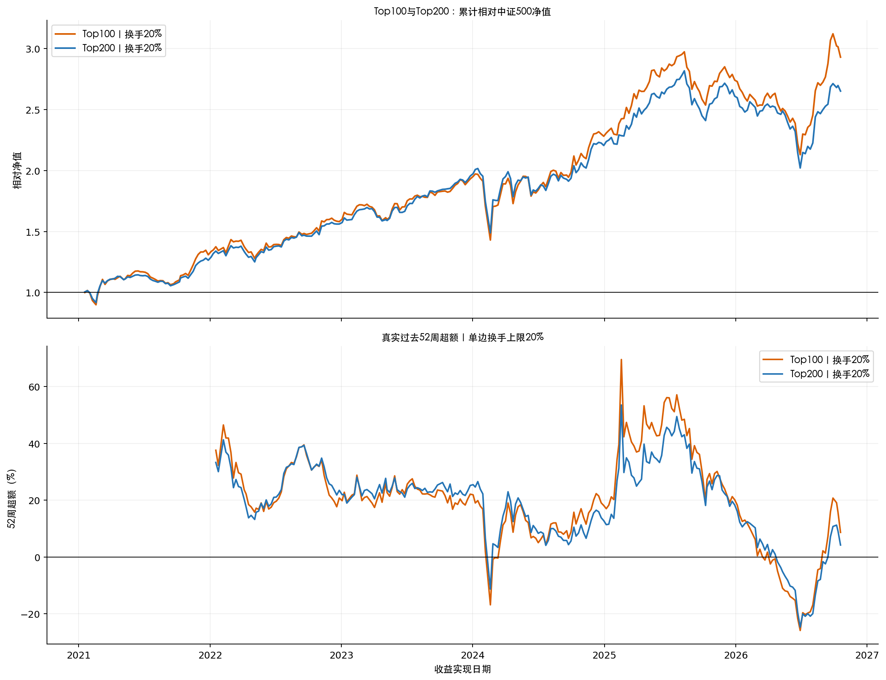

# A股多因子研究：从 V1 到 Top100

这是一份**研究过程归档**，整理公开单因子评估、全市场指增、200 多/200 空、单调性筛选、ICIR 线性组合、双通道 CNN＋XGBoost、全局周历修复、换手约束及最新 Top100 实验。它保存方法、结果、图和关键复算口径，方便上传 GitHub 后与研究员逐项核对。

> **先看结论**：最新的双通道融合 **Top100＋单边周换手上限 20%** 在修正后的 295 期周历上，历史年化净收益 **21.05%**、相对官方中证500的几何年化超额 **20.48%**、最大回撤 **−31.78%**。这是研究回测；XGBoost 的候选因子名单用过 2021—2025 年表现事后筛选，所以该结果**不是严格独立样本外成绩**。20% 换手限制使平均仅约 40.36% 仓位在当周最新 Top100，且最大单票权重曾到 14.51%。

## 阅读顺序

1. [版本总表与每版详细设置](docs/01_版本沿革与结果.md)
2. [交易时间、换手、费用与收益公式](docs/02_交易与指标口径.md)
3. [图表索引与读图说明](docs/03_图表索引.md)
4. [数据、复现方式与已知局限](docs/04_复现与审计.md)
5. [最新 Top100 与 Top200 逐年对照](results/top100_vs_top200.csv)

## 版本命名说明

早期的“V1—V4”是全市场组合优化实验；之后口头约定的“第四版”指**六年训练、一年测试的滚动全市场指增**，“第五版”指**全市场 Top200 多/Bottom200 空**。磁盘上的文件夹曾采用不同编号。本仓库按研究时间线写出实验名称，并在文档中注明原目录，避免把同名版本误当成同一结果。

## 最后一个实验的比较

| 冻结的50/50融合信号 | Top100，20%单边换手 | Top200，20%单边换手 |
|---|---:|---:|
| 年化净收益 | 21.05% | 18.97% |
| 几何年化超额，对官方中证500 | 20.48% | 18.42% |
| 最大回撤 | −31.78% | −28.34% |
| 平均实际单边周换手，包含首仓 | 20.15% | 20.22% |
| 各周费用率的算术和 | 11.74% | 11.78% |
| 仍属于当期目标名单的平均仓位 | 40.36% | 44.52% |

图：

**图中正的超额只说明该历史窗口跑赢官方指数。**图中的滚动52周收益是截至横轴日期已经实现的过去364天左右复合相对收益，不是未来预测；滚动窗口会产生基期效应。2026年只到10月，不能当全年比较。

## 仓库边界

`figures/` 是精选原图，`results/` 是便于核对的小型表格，`code/` 保存与最新交易及换手计算直接相关的原始研究脚本快照。原始个股行情、完整预测矩阵、模型权重、研究员提供的 Barra 实现和大体积中间文件不进入公开仓库。**仅 clone 此仓库不能从零重跑模型**；所需数据、原工程和运行入口见[复现说明](docs/04_复现与审计.md)。图和结果来自历史记录，打包时未重算或调参。

本仓库未附开放许可证；上传前请确认数据、图及代码的公开授权范围。
