# A股多因子研究完整过程：从公开单因子到双通道 Top100

> **研究记录，非投资建议。**本文按实际探索顺序记录每一阶段“输入是什么、怎样计算、产生什么输出、图怎样读、结果有什么限制”。不同阶段有不同因子、训练窗口、调仓和费用口径，图表不能只凭曲线高低直接比较。文中“官方中证500”均指数据库 `000905.SH`，除特别注明外，最新回测按开盘到开盘计收益。

## 读这篇文章前先分清四层东西

这项研究经历了四层计算。**因子**是某天某只股票的一个数，例如过去60天成交量变化；**单因子检验**是在历史上问“这个数能不能把未来涨得更好的股票排前面”；**模型预测**是同时使用多个因子，估计每只股票未来一段时间的相对收益；**组合回测**才把预测变成持仓、买卖和净值。单因子 IC 高，不等于这个因子进入多因子模型后贡献高；模型排序相关为正，也不等于买入最前200只扣费后一定跑赢中证500。

整个过程有两条主线：较早的**全市场优化指增**，强调用行业、风格和其他约束使组合接近指数；后来还探索了**简单多头/多空与双通道预测**，强调先确认预测排序有没有实际收益优势。口头“第四版”与磁盘目录 `all_market_v4` 曾不是同一实验，因此下文每次都写具体名称。

---

## 1. 数据、时间轴和最初的694个有效公开因子

### 1.1 使用过什么数据

原始研究使用本地A股日线、股票交易状态、上市日期、行业变化表 `industry_chg`、中证500指数日线 `000905.SH`、中证500历史成分权重代理 `zz500_wgt`，以及公开因子库 Alpha158、Alpha360、GTJA191 的公式与计算结果。原始行情覆盖约2011年底到2026年10月；后面各实验使用不同的训练与测试年份。`index_wgt.parquet` 是空表，不能作为日度指数权重。研究员说明 `zz500_wgt` 是按公开调样成分和中间股价变化推算的日度权重；它不是向中证指数公司购买的完整官方逐日权重。

数据至少要按股票代码、交易日期对齐，区分因子观察日、收益标签结束日、信号日、实际成交日和收益实现日。尤其要防止两个常见错误：一是2018年的预测使用2019年财报或未来行情；二是把股票在未来持有期没有开盘价这一**未来才知道的事实**用于当天选股过滤。后来的单因子重检专门修正过后者。

### 1.2 最初公开因子如何单独评价

最初 `open_factor_v1` 共有695个公式，694个可计算并参与主要评估；Alpha360 的 `CLOSE00` 按原始公式为“当日收盘价除以当日收盘价，再减1”，结果恒为0，是结构性常数而非有效预测因子。对每个可用因子，在每个评价日先取当日可观察的股票因子值，再与该评价定义下**下一期收益**对齐。每一天计算横截面 Spearman 排序相关：

$$
IC_t=\operatorname{Spearman}\!\left(F_{i,t},\,R_{i,t+1}\right)_{i\in\mathcal U_t}
$$

其中 $\mathcal U_t$ 是当日可评价的股票集合。一个因子若常把未来涨得更多的股票排前面，平均 IC 往往为正；若总把未来较差的股票排前面，平均 IC 往往为负，后续可以反向使用。平均 IC 与最早报表的 ICIR 分别为：

$$
\overline{IC}=\frac{1}{T}\sum_{t=1}^{T}IC_t,
\qquad ICIR=\frac{\overline{IC}}{\operatorname{Std}(IC_t)}
$$

这里的 ICIR 是**日度、未年化**的稳定性比值。它不是“预测正确率”，也不是近年模型周度 ICIR。原报表还包括 `ic_tstat`、IC为正的日期比例、IC年化表示、方向性多空收益/波动/夏普/回撤、分组收益单调性、IC滞后衰减、自相关、换手、平均可用股票数。对于负向因子，要先统一“因子值越大，预期收益越高”的方向，才能和正向因子比较或组合。

分组检验则是在同一天按因子值排序成若干组，分别计算下一期持有收益，并随时间复合或年化。这回答“高因子值的一组比低因子值的一组是否更强”；IC回答的是整个股票横截面排序关系。两者相辅相成，但不是同一个指标。

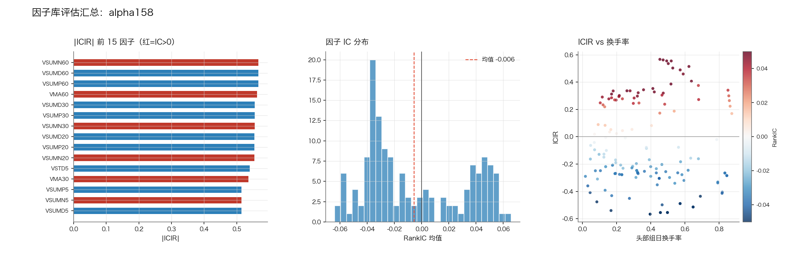

**读图**：这是早期 Alpha158 的单因子仪表盘示例，用于看某一类公开因子的分布和检验指标，不是一个实际股票组合的资金净值。早期评估频率、收益定义和后面每周开盘到开盘回测不一致，切勿把两处IC/ICIR直接相减。

### 1.3 早期两条并行尝试

最先试过“粗筛→去相关→本地CNE6风险风格和行业正交残差”的路线：粗筛约105个，去相关约34个，最终约33个残差因子。每日在股票横截面回归原始因子对行业和风格暴露：

$$
F_{i,t}=\beta_{0,t}+\boldsymbol\beta_{I,t}^{\mathsf T}\mathbf I_{i,t}
+\boldsymbol\beta_{S,t}^{\mathsf T}\mathbf S_{i,t}+\varepsilon_{i,t}
$$

其中残差 $\varepsilon_{i,t}$ 被当成较少包含这些共同风险方向的新信号。它依赖本地公开公式复现，**不等于官方Barra模型，也不能把残差的全部收益称为纯阿尔法**。

另一条路线保留40个相互相关性尽量低的**原始因子**，用历史ICIR动态加权做Alpha预测，再在中证500成分里构造300只指数增强组合。早期规则曾有月度选股、日度风险约束和成交处理；该路线与后来的“全市场XGBoost”不是同一模型。它帮助我们认识到：因子有效性、指数历史权重、开盘成交时序、现金分红及复权口径都可能改变所谓“超额”。因此后续对官方指数、`zz500_wgt`被动复制组合与增强组合做过基准审计。

---

## 2. 全市场优化 V1：40个原始因子、XGBoost、贴近中证500

早期40因子之后，我们改成**全市场**作为股票候选，而不是只在中证500成分内选择。固定因子输入后，以2016—2020年训练 XGBoost，对2021—2025年产生预测；每周对全市场合格股票估计未来一周相对指数收益，再由优化器决定每只股票权重 $w_i$。这里的 $w_i$ 是投入该股票的资金占总资金比例，所有长仓权重非负、总和接近/等于1，不是因子权重。

优化器追求较高的预测Alpha，同时把组合相对中证500的**行业权重和本地CNE6风格暴露**压在研究者设定范围内。研究时使用过的具体限制包括：单股最多1%，指数外单股最多0.5%，成分股相对指数权重最多超配0.5个百分点，行业偏离±2个百分点，本地25个风格因子偏离±0.02标准化单位，主动权重总量约45%，周单边换手最多20%，预测年化跟踪误差最多6%。买入/卖出简化费用分别5/15bp。上述数字是这版的**实验参数**，不是行业统一标准。目标优化可行并不保证停牌、涨跌停、现金残留等实际执行后仍满足约束。

### 2.1 原优化器的数学形式与求解细节

令 $\alpha_i$ 表示模型预测的相对收益，$b_i$ 表示 `zz500_wgt` 对应的基准权重，$p_i$ 表示上期漂移后的权重，$w_i$ 表示本期目标权重。原优化器用线性规划最小化：

$$
\min_{\mathbf w,\mathbf{buy},\mathbf{sell}}
\left[-\sum_i\alpha_iw_i
+0.0005\sum_i buy_i
+0.0015\sum_i sell_i\right]
$$

其中买入和卖出辅助变量均非负，并满足

$$
w_i-buy_i+sell_i=p_i,\qquad buy_i\ge0,\quad sell_i\ge0.
$$

目标函数同时鼓励高预测收益、惩罚买卖费。它还为 $|w_i-b_i|$ 引入非负辅助变量，以表达主动权重限制。由于目标中买卖费为正，最优解一般不会无故同时报买和卖同一股票。

基础仓位和个股上限为：

$$
\sum_iw_i=1,\qquad 0\le w_i\le\min(1\%,\,b_i+0.5\%).
$$

若股票不在指数成分内，再要求 $w_i\le0.5\%$；不合格股票 $w_i=0$。行业与风格偏离约束分别为：

$$
\left|\sum_{i\in\mathcal I_g}(w_i-b_i)\right|\le2\%,
\qquad
\left|\sum_i S_{ik}(w_i-b_i)\right|\le0.02.
$$

这里 $\mathcal I_g$ 是行业 $g$ 的股票集合，$S_{ik}$ 是股票 $i$ 对本地风格因子 $k$ 的暴露。主动权重和换手约束为：

$$
\frac12\sum_i|w_i-b_i|\le45\%,
\qquad
\sum_i(buy_i+sell_i)\le40\%.
$$

买卖资金大体相等时，后一个约束相当于约20%单边换手。以上是**目标权重**的约束，成交失败、停牌或开盘涨跌停后的实际仓位不由这组线性约束自动保证。

跟踪误差另用过去252个交易日的个股收益估计协方差：日收益先裁到±30%、缺失按0，协方差取75%样本协方差加25%对角方差；对角方差下限为 $0.02^2$。令主动权重 $\mathbf a=\mathbf w-\mathbf b$，预估年化跟踪误差为：

$$
TE=\sqrt{252\,\mathbf a^{\mathsf T}\Sigma\mathbf a}\le6\%.
$$

因为跟踪误差是二次型而主问题是线性规划，程序先解线性规划，若超限则在当前点加梯度线性切面重解，最多迭代8次；未收敛返回失败。这是一种研究近似求法，不保证任意市场状态都能给出满足全部目标的组合。

V1的旧记录显示相对官方中证500年化收益差约+3.19个百分点。注意这是旧训练/执行/周历口径的探索结果，后续版本改变了输入、筛选、窗口和持仓，不能据此说V1比某版“模型能力更强”。

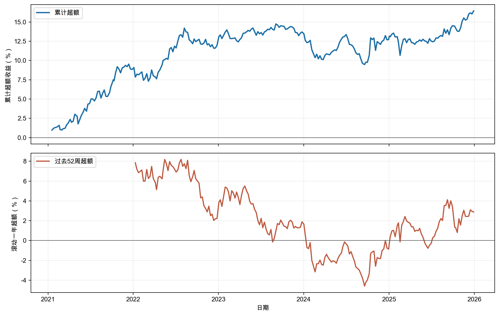

**读图**：纵轴若为相对净值，1表示从起点至今与官方指数一样；高于1说明该历史路径累计跑赢。图中上升并不说明每一周都跑赢，也不说明行业/风格约束在成交后的真实持仓始终满足。

---

## 3. V2/V3/V4：从694个因子重新筛选，再训练同类全市场模型

### 3.1 IC门槛与相关性去重到底怎样做

V2不用原来的固定40因子，先在训练期内计算694个原始因子的平均 Rank IC，保留严格 `IC>0.01` 的476个候选。然后按平均IC从大到小逐个处理，维护已入选因子矩阵：候选与已入选因子的抽样横截面**绝对相关系数**只要超过0.75，就认为信息高度重复，保留先进入、平均IC更高者；否则加入。相关性基于2015—2019年48个抽样交易日、每日至多800只合格A股的秩值，最终剩95个。这里的“低相关”只对这套抽样矩阵成立，无法保证未来每一天仍低于0.75。

V3先试 `IC>0.03`：428候选去相关后60个，此时**只完成筛选**，不能报告新的模型收益。随后把阈值改为 `IC>0.04`：251候选去相关后35个，用这35个重训XGBoost。V3完整回测使用2015—2020年训练、2021—2025年测试，仍走全市场优化。V4短测则保持V3方法，只将测试缩为2021年，不应把它当成五年滚动检验。

在可核查的V3训练脚本里，回归目标是下次开盘到下次周调仓开盘的**股票收益减官方中证500同区间收益**，训练标签截到±30%。XGBoost使用平方误差回归、`hist`树、240棵、最大深度4、学习率0.05、`min_child_weight=40`、行抽样0.8、列抽样0.8、L2=20、L1=0.1、`max_bin=128`、固定随机种子；它输出每只股票的连续预测相对收益，不是“上涨/下跌分类正确率”。脚本曾把2015—2018拟合/2019—2020检查作为开发期诊断，最后再用2015—2020全部数据拟合冻结模型。**因35因子名单本身用过2015—2020的IC筛选，2019—2020开发期检查不是未接触的独立验证。**

| 实验 | IC门槛 | 门槛后 | 绝对相关>0.75去重后 | 结果口径 |
|---|---:|---:|---:|---|
| V2 | >0.01 | 476 | 95 | 年化净收益3.89%，指数2.65%，几何超额1.21% |
| V3筛选草案 | >0.03 | 428 | 60 | 停在筛选，不对应新收益 |
| V3完整 | >0.04 | 251 | 35 | 年化净收益3.97%，指数2.65%，年化收益差约+1.31个百分点 |

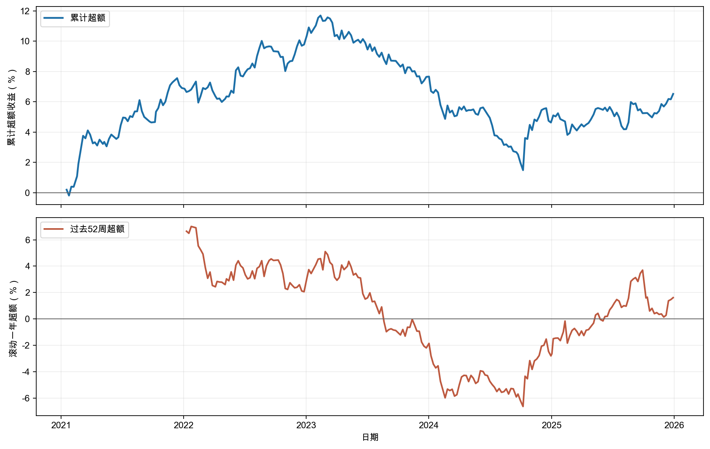

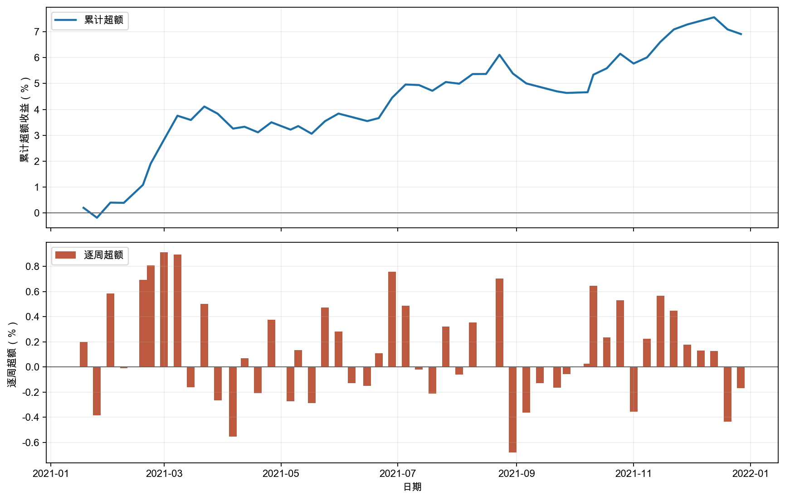

**读图**：第一张是35因子完整测试，第二张只含2021年。V2、V3与V1虽然都叫全市场指增，但因子输入和训练期不同。旧回测多次出现**目标权重满足风险限制，实际成交后风格/行业偏离超限**，所以风险“压住了”仅指优化目标，不能无条件扩展到成交后仓位。

---

## 4. 第四版：六年训练、一年测试的滚动全市场优化

固定一次训练再跨很多年测试，容易把某一段市场结构当成长期规律。于是改成每轮向前滚动：2015—2020训练→2021测试；2016—2021训练→2022测试；依此直到2020—2025训练→2026年1—10月测试。每轮重新算单因子IC、执行 `IC>0.04`、相关性>0.75去重、重训XGBoost，再做全市场周度权重优化，让收益目标大、行业/风格接近中证500。**这不是六年数据每周都回头用未来标签训练**；测试年的模型只能使用之前训练期可获得的信息。各年测试结果再按日期拼成历史探索序列。

旧滚动组合记录约为策略年化1.00%、官方指数0.47%、几何年化超额0.54%、最大回撤−40.19%。这里的数字用于定位“全市场预测有排序信息，但严约束/成交/费用可能吞掉优势”。后续审计发现跨年周度信号日曾重复，这一旧图属于**历史探索图**。

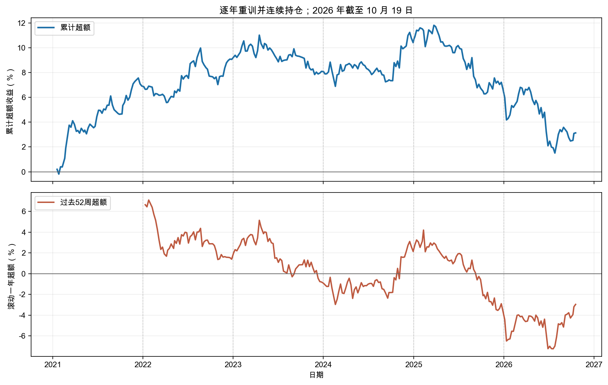

**读图**：相对净值如果某段下降，表示该段跑输指数；它不自动说明是哪一步导致，需逐周拆“预测→目标权重→实际仓位→毛收益→费用→净收益”。旧日历图不可拿来验证最新修复后52周统计。

---

## 5. 第五版：200只多头与200只空头，先观察模型排序的两端

研究员建议暂时跳过行业/风格优化，直接看模型预测排序：每周全市场预测最高的200只组成等权多头、最低的200只组成等权空头。多头回答“最看好的股票单独表现如何”；多空回答“看好的一端减去看坏的一端，排序两端差异有多大”。如果空头涨得比多头还多，多空会亏；如果全市场涨得很强，多头可能赚，但相对中证500仍可能输。**多头相对指数超额、多空组合净值不是同一指标。**

旧探索记录的年化：多头毛19.41%、简化费后9.22%；多空毛73.46%、简化费后47.06%。这些是研究模拟，空头没有完整融券可得性、借券费、保证金及强平成本；旧周历问题同样适用，不能宣称实盘可做。

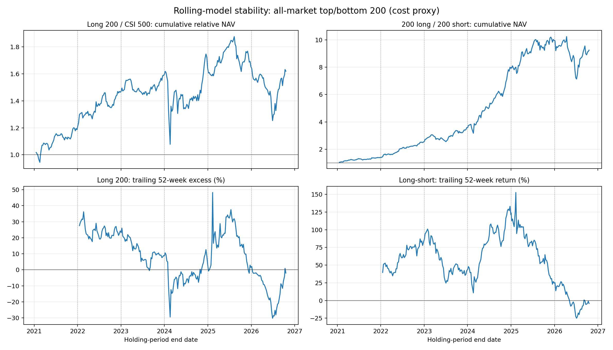

**读图**：上左是200只多头相对中证500的累计净值，上右是200多/200空自身累计净值；下方分别看过去一段时间的多头超额和多空收益。上右约10的纵轴与上左约1.6不是同一种收益口径，绝对不能读成“多头跑赢指数10倍”。

---

## 6. 第六版：给200只加行业和风格约束，为什么反而困难

先固定最高预测的200只，只在这200只内部用优化器选择权重，使组合本地CNE6风格和行业贴近中证500。但若这200只本身行业偏向很强，权重怎么分配也无法补出没有股票的行业，严格风险约束会不可行。固定200实验正暴露出这个问题，实际仓位也频繁偏离目标风险范围。

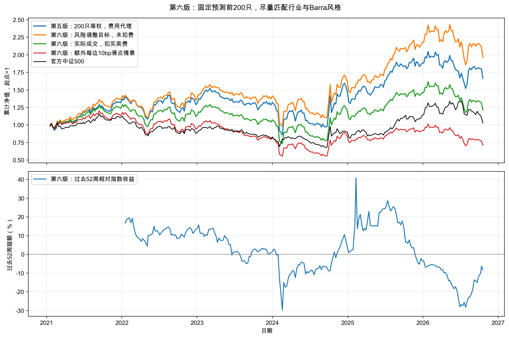

于是允许用预测排名更靠后的股票替换，目标仍是约200只持仓，优化器兼顾预测Alpha与基准行业/风格。目标风险约295/296期满足，但平均仅约41.9只仍来自原最高200名；简化费后年化约−2.80%，官方指数约+0.47%。成交后的行业、风格仍可能因无法成交或价格漂移越界。这个实验说明**“选最高分”和“严格贴近指数风险”会发生取舍**，不是说模型排序能力突然消失。

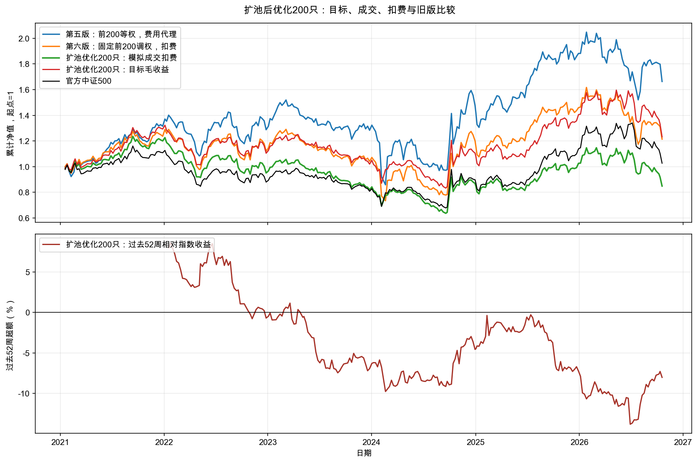

**读图**：两张图可以比较风险约束对持仓和收益路径的影响，但固定200与扩池200的实际股票名单已大幅不同，不能把两曲线差全归因于一个约束数值。

---

## 7. 第七版：先筛收益分组单调的因子，再做严格风险指增

我们希望保留对**多头端**较有帮助的单因子。每轮只使用过去六年训练期，按每个因子在训练期股票上的取值把股票分成10组，计算各组的年化收益 $R_1,\ldots,R_{10}$，再求：

$$
\rho=\operatorname{Spearman}\!\left((1,2,\ldots,10),\,(R_1,R_2,\ldots,R_{10})\right).
$$

若 $\rho$ 大于等于正向阈值则保留正向；若小于等于负向阈值则保留反向并在后续取负；其余剔除。这里是对**10组收益排序**的相关，不要求每相邻两组都严格递增。之后才依次做正向化平均Rank IC大于0.04、绝对相关超过0.75去重、训练XGBoost、对下一年全市场股票做严格本地行业/风格风险优化。

强门槛 $|\rho|\ge0.9$ 六轮入选因子数依次23、8、6、6、10、11；放宽为 $|\rho|\ge0.6$ 后依次36、26、20、16、26、18。单调性阈值变小使更多因子入选，但**入选数更多不保证组合收益更好**。两版2024年都在严格优化环节出现不可行，图中断点不能拼成完整2024年净值。

| 回测年 | ρ≥0.9入选 | ρ≥0.6入选 | ρ≥0.9年化收益差 | ρ≥0.6年化收益差 |
|---|---:|---:|---:|---:|
| 2021 | 23 | 36 | +3.90百分点 | +7.41百分点 |
| 2022 | 8 | 26 | −0.94 | −0.08 |
| 2023 | 6 | 20 | −0.63 | +0.61 |
| 2024 | 6 | 16 | 严格回测未完成 | 严格回测未完成 |
| 2025 | 10 | 26 | −5.29 | −4.71 |
| 2026至10月 | 11 | 18 | +1.42 | +1.21 |

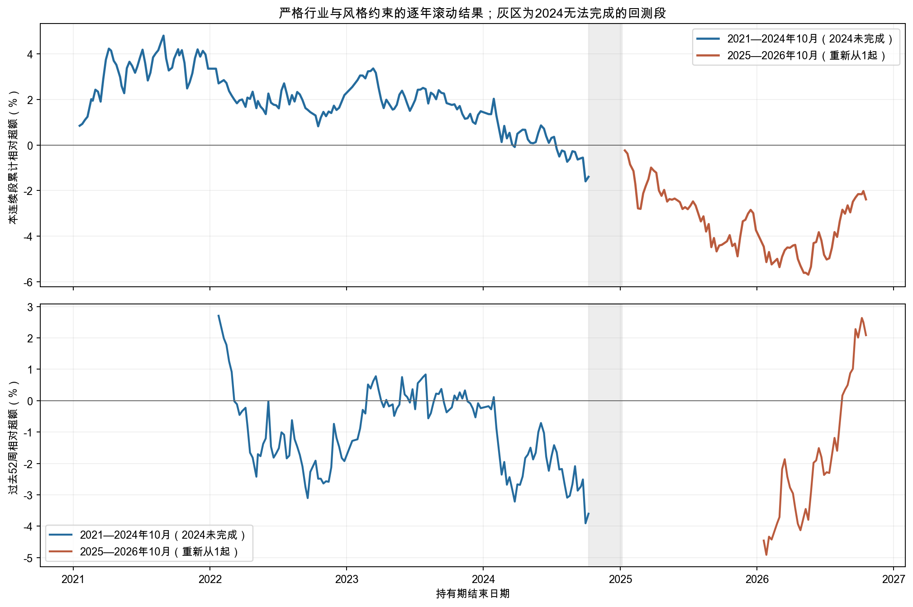

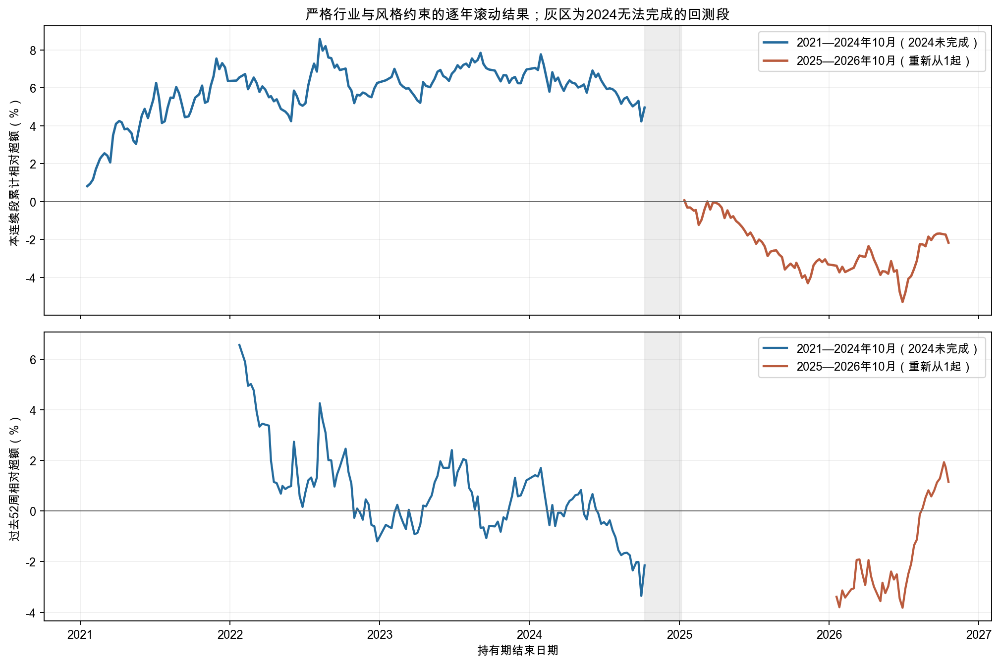

**读图**：断线处不是净值为零，而是严格约束回测中断。旧严格版曾在观察下一开盘可交易状态之后又假设于同一开盘价成交，存在乐观执行时序；因此即便图中某年超额为正，也不能当成已严格实盘验证。

---

## 8. 第八版：沿用第七版模型，但直接买预测最前200只

第八版沿用第七版 $|\rho|\ge0.6$ 的逐轮入选因子与XGBoost预测，把后面的Barra行业/风格优化去掉。每周全市场预测最高200只等权多头，对比官方中证500。这样更直接地看“模型认为最好的股票”有没有多头收益优势。

相对指数的年度年化收益差（百分点）为2021 +36.38、2022 +23.61、2023 +28.00、2024 −8.38、2025 +12.85、2026截至10月 +6.63。2024年仍不稳，说明去掉风险约束虽释放了预测暴露，也会暴露组合的行业、市值与指数结构差异。该版沿用旧简化换股数费用代理，没有最新修复版的真实权重漂移成交成本。

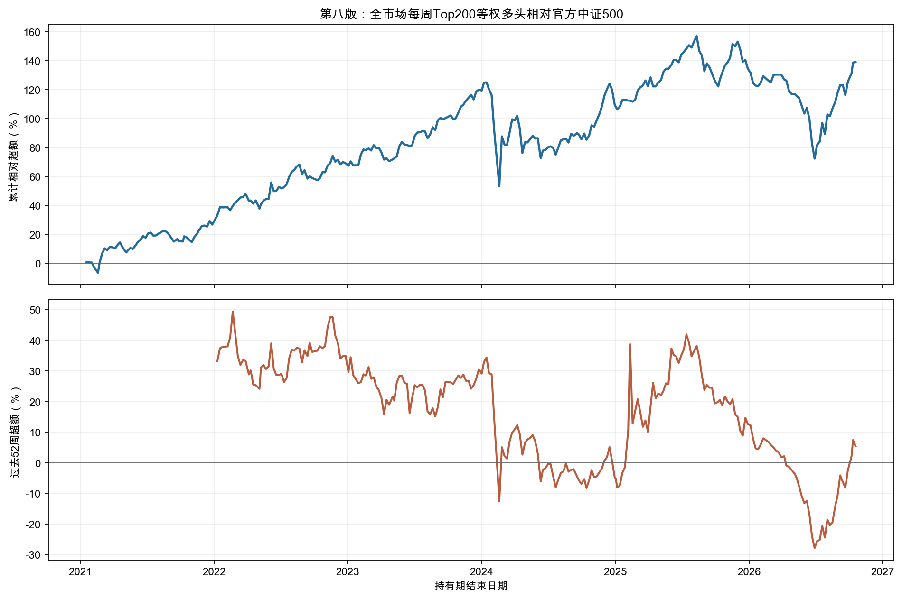

**读图**：图里的“跑赢中证500”可以同时由因子选股、行业配置、市值风格等造成；它不能单凭这张图证明获得了剔除风险后的纯Alpha。

---

## 9. 第九版：ICIR门槛、三库各三分之一、线性组合

曾想用 $|ICIR|>1$ 筛因子，但最初六年窗口的未年化日度ICIR没有因子达到1。带教建议将门槛改成0.45，并避免 Alpha360 因子数量更多而主导信号。于是每轮在训练窗口内用原始单因子每日IC序列计算ICIR，保留 $|ICIR|>0.45$，负向因子先反转；三个因子库内部各自合成，然后固定每库贡献三分之一：

$$
S_{\mathrm{linear}}=\frac13S_{\mathrm{Alpha158}}
+\frac13S_{\mathrm{Alpha360}}
+\frac13S_{\mathrm{GTJA191}}.
$$

它是**线性组合**，即按固定权重相加，不训练XGBoost；更不是“每个因子单独占1/3”。每周全市场分别取信号最高Top50、Top100、Top200等权做多，不加本地Barra风险约束。六年ICIR窗口的逐轮入选因子数102、109、101、99、65、16；之后只改为过去一年窗口，入选数12、13、22、49、74、114。短窗口更灵敏但可能更噪，长期/短期ICIR值不能只看因子数量推断效果。

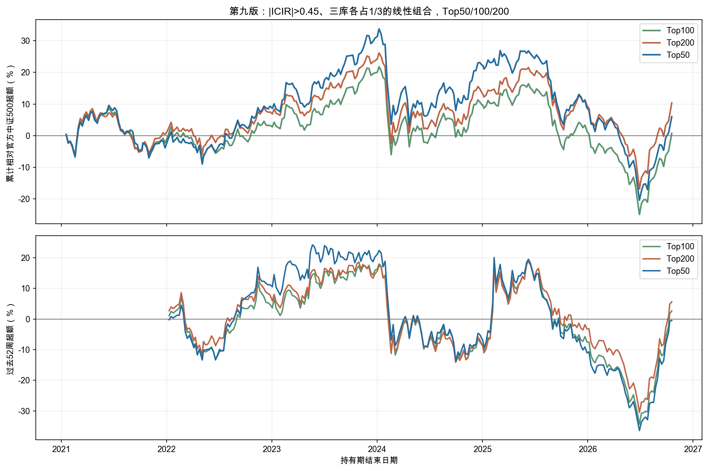

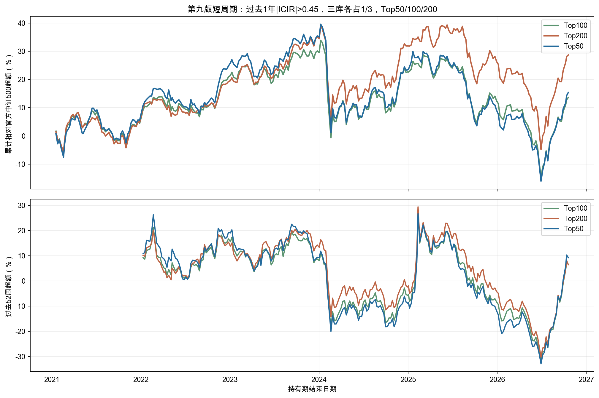

**读图**：三条不同Top数量的曲线在2024—2025均有不理想阶段。比如六年窗口2025年Top50/100/200相对官方年化收益差约−21.02/−16.67/−10.48个百分点；一年窗口约−24.82/−18.87/−12.61。由此不能说缩小为Top50必然更稳。这里仍是旧版费用与成交代理。

### 9.1 逐个检查694因子，为什么后来出现354名单

为了区分“因子本身弱”还是“模型把信号用坏”，曾对694个原始因子逐个做下一年Top200多头检验，并比较全市场等权池及官方中证500。后来修复两件事：**单因子筛选阶段不扣组合交易费**；选前200只之前只用当时已知因子和可用性，不用未来开盘价完整性提前筛股票。基于历史胜出筛出的354个名单用于**诊断和后续实验候选**。但它是看过2021—2025年表现后得到的，若用它训练并再报同段“样本外”收益，就有候选名单事后选择偏差。这是后续双通道模型最重要的可信度限制之一。

---

## 10. 双通道：完整Alpha360给CNN，非Alpha360历史优胜候选给XGBoost

### 10.1 为什么做双通道、输入如何严格分开

Alpha360 具有比较自然的**60个历史交易日×6类价量特征**结构，适合沿时间维度卷积；Alpha158/GTJA191是不同定义的横截面表格因子，更适合树模型。CNN使用完整Alpha360 **360个位置**，不能从354历史优胜名单里只拿258列充数。磁盘原先有359列，缺少的是按原始公式恰好为0的 `CLOSE00`，因此按定义重建常数0并记录，而不是对未知特征任意填0。六类是 OPEN、HIGH、LOW、CLOSE、VWAP、VOLUME，历史顺序不得打乱。

XGBoost通道只读354名单里**非Alpha360**的96个候选：Alpha158 52、GTJA191 44；训练期内按绝对相关>0.8去重，并依训练期 $|ICIR|$、方向稳定性、$|IC|$ 的规则决定保留，六轮分别剩57、57、58、56、56、58。这里与早期“IC大于0.04、相关性大于0.75”的筛选规则**不同**，不能混写成双通道模型也用0.04/0.75。

### 10.2 标签、预处理、网络和训练

两个通道预测同一股票、同一信号日的“未来5个交易日股票收盘收益减去同期官方CSI500收盘收益”。CNN输入形状为 `[样本, 60, 6]`，卷积沿60天时间轴：`Conv1D(32,kernel=3) → Conv1D(64,kernel=5) → GlobalAveragePooling → Dense(64) → Dropout(0.2) → Dense(1)`。每轮的0.5%/99.5%缩尾边界、缺失填补、均值和标准差只由训练集估计，再应用于验证/测试。CNN计算量控制：训练日确定性最多抽512只、验证日最多1024只，测试日对所有合格股票评分。

XGBoost每轮在两个预先固定参数组中用验证集选，最多600棵树，验证集early stopping容忍30轮；CNN学习率及停止轮次也只按验证期周度平均Rank IC确定。训练和验证用的股票/日期/标签索引对齐，测试期不回调参数。每轮在同一天的共同股票池内分别标准化两路信号，然后固定按一半对一半融合：

$$
z_{i,t}^{(m)}=\frac{s_{i,t}^{(m)}-\overline{s}_t^{(m)}}{\sigma_t^{(m)}},
\qquad
S_{i,t}^{\mathrm{final}}=\tfrac12z_{i,t}^{\mathrm{CNN}}+\tfrac12z_{i,t}^{\mathrm{XGB}}.
$$

其中 $m$ 分别代表CNN和XGBoost，均值与标准差只在当日共同股票池内计算。50/50是事先固定，不按测试收益重新挑权重。

### 10.3 六轮训练、验证、测试以及Purge Gap

| 轮次 | 训练 | 验证 | 测试 |
|---:|---|---|---|
| 1 | 2015—2019 | 2020 | 2021 |
| 2 | 2016—2020 | 2021 | 2022 |
| 3 | 2017—2021 | 2022 | 2023 |
| 4 | 2018—2022 | 2023 | 2024 |
| 5 | 2019—2023 | 2024 | 2025 |
| 6 | 2020—2024 | 2025 | 2026年1—10月 |

每个训练→验证、验证→测试边界都真正删除前段末端**5个交易日标签可能跨界**的样本，并核查标签结束日严格早于下一段开始日；12个边界通过。CNN可以读取预测日前60天历史输入，但不能读取预测日之后特征；2026年10月以后不能被拿来补齐末端标签。**Purge Gap只能防标签跨界，不能修复354候选名单提前用过测试表现的问题。**

### 10.4 统一回测：从信号到下一周已实现收益

每个正式信号日取当周最后一个实际交易日，收盘后生成信号；下一交易日开盘买入最高200只，初始每只0.5%，持有至下一正式周信号后的下一交易日开盘。股票池过滤ST、停牌、涨跌停不可交易、上市不足180天以及成交量/金额等无效值；合格股票池是当时全市场动态集合，不是固定现在的股票，也不限定中证500成分。官方基准用 `000905.SH` **同入场与结算开盘**收益。注意模型训练的未来5日收盘标签与这里真实交易持有区间是两种不同定义。

最初双通道图以各日历年分别生成周度信号，导致2024-12-31和2025-01-03落在同一个星期五截止周，却产生两次调仓；旧“滚动52行”也不能代表真实过去52自然周。这是正式修复前旧图的主要问题。

---

## 11. 正式修复全局周历、真实权重漂移、费用与滚动52周

### 11.1 周历修复到底改了什么

在2021—2026年10月**完整交易日历**上，按星期五截止周统一分组，每个周只保留最后一个实际交易日。2024-12-31的旧重复信号删除；2024-12-27信号于2024-12-30开盘进入，延长持有至2025-01-06开盘实现收益；下一信号2025-01-03，同年1月6日开盘入场至1月13日开盘实现。修复后295个正式信号、重复周0、294对相邻持有区间首尾连续。节假日不插入虚拟周，长假持有段自然更长。模型预测、训练、验证、超参数、50/50融合权重不因修历而改变。

### 11.2 每周如何从股票价格算到组合净值

设 $w_{i,t}$ 为期初成交后权重，$r_{i,t}$ 为股票在该持有期的开盘到开盘收益。组合毛收益为：

$$
r_t^{\mathrm{gross}}=\sum_i w_{i,t}r_{i,t}.
$$

持有期结束，股票涨跌使下期交易前权重漂移：

$$
\widetilde w_{i,t+1}
=\frac{w_{i,t}(1+r_{i,t})}{\sum_j w_{j,t}(1+r_{j,t})}.
$$

无换手限制的Top200在下期又把新名单200只各恢复到0.5%。设新目标权重为 $w_{i,t+1}^{\mathrm{target}}$，把目标与漂移权重的正负差额分别加总：

$$
B_{t+1}=\sum_i\max\!\left(w_{i,t+1}^{\mathrm{target}}-\widetilde w_{i,t+1},0\right),
\qquad
S_{t+1}=\sum_i\max\!\left(\widetilde w_{i,t+1}-w_{i,t+1}^{\mathrm{target}},0\right).
$$

因此，保留的旧股票即使没换名字，涨多或跌多造成的再平衡也会产生交易金额。首次空仓建仓为 $B=1,S=0$。

简化买入费率5bp是0.0005，卖出费率15bp是0.0015。依照原程序的直接减费约定：

$$
\begin{aligned}
c_t&=0.0005B_t+0.0015S_t,\\
r_t^{\mathrm{net}}&=r_t^{\mathrm{gross}}-c_t,\\
P_t&=P_{t-1}(1+r_t^{\mathrm{net}}).
\end{aligned}
$$

这里卖出15bp是统一简化费率，不能精确拆称某一税种；没有额外滑点、冲击、融资、借券、订单簿排队的完整模拟。官方中证500指数价格序列没有组合交易费；若要模拟投资者买指数基金，另需基金费及交易成本，不能把指数价格直接当可免费复制的投资账户。

无上限Top200的单边与双边换手分别是：

$$
\text{单边换手}_t=\frac{B_t+S_t}{2},
\qquad
\text{双边换手}_t=B_t+S_t.
$$

例：当周卖20%且买20%，单边换手20%，双边换手40%，费用 $0.0005\times0.20+0.0015\times0.20=0.0004$，也就是净值扣0.04个百分点；若毛收益1%，本程序净收益0.96%。费用按真实**资金比例**算，不等于“换掉多少只/200”。

### 11.3 最新修复后，三模型真实结果

| 通道 | 周度Rank IC | 周度ICIR | 年化净收益 | 几何年化超额 | 最大回撤 | 平均单边换手 | 逐周费用率之和 |
|---|---:|---:|---:|---:|---:|---:|---:|
| CNN | 0.0747 | 0.585 | 11.95% | 11.43% | −34.61% | 59.70% | 35.17% |
| XGBoost | 0.0789 | 0.678 | 10.43% | 9.92% | −36.42% | 91.11% | 53.70% |
| 50/50融合 | 0.0871 | 0.697 | **13.48%** | **12.96%** | −35.98% | 72.98% | 43.01% |

“费用率之和43.01%”是295周各周费用率的**算术和**，不是年化费用，也不是毛净值简单差43.01%；真实净值是每周扣费后复合出来的。融合模型平均买入金额73.15%、平均卖出金额72.81%，单边换手平均72.98%，说明虽然模型排序相关较好，原始Top200策略交易十分频繁。融合优于单通道是同股票池/周历/费用口径下的观察，但前述354候选名单风险仍在。

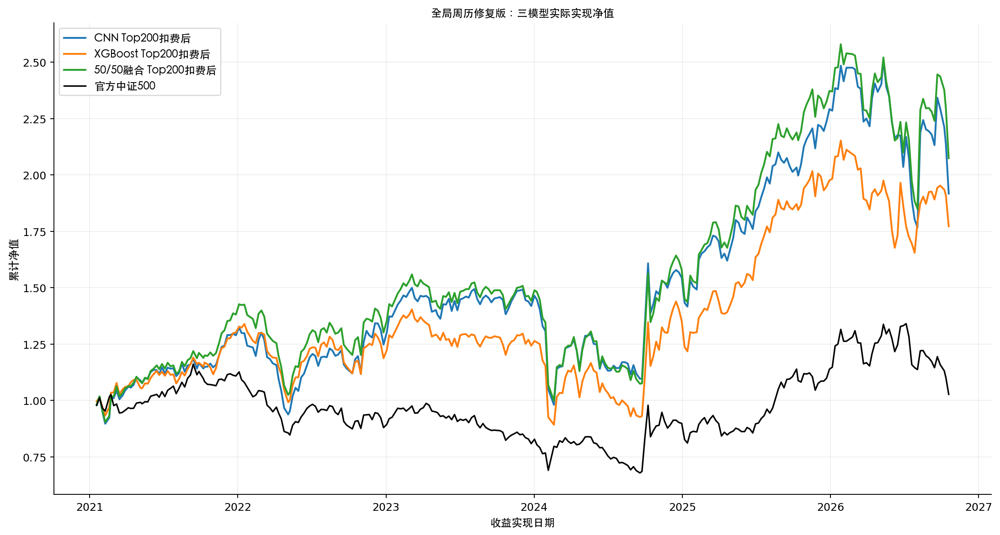

**读图**：这张是CNN、XGBoost、融合策略与官方中证500的**绝对净值**；融合曲线高于指数不意味着每年都跑赢。逐年按**收益实现日期**归属，融合2021—2026年相对指数复合收益分别约+24.58%、+18.74%、+20.54%、−1.40%、+18.50%、−3.07%；2026非全年。

### 11.4 “过去52周超额”为何会突然跳

设截至收益实现日 $t$ 的策略和指数净值分别为 $P_t$、$I_t$。找 $t-364$ 自然日当日或之前最近一个**已经完成持有期**的观察点 $a$，计算：

$$
E_{52\mathrm{w},t}
=\frac{P_t/P_a}{I_t/I_a}-1.
$$

窗内可能包含51或52个持有段，绝不默认“最近52行”；横轴必须是收益实现日，不可把未来才结算的收益标在信号日。2025年初的陡升有真实的**基期效应**：2024年2月初极大的相对亏损离开过去52周窗口。旧图把约45.29%提早标在2025-01-27信号日，是错的；修复后该日已知值约0.97%，至2025-02-17实际收益实现后滚动值约45.99%。

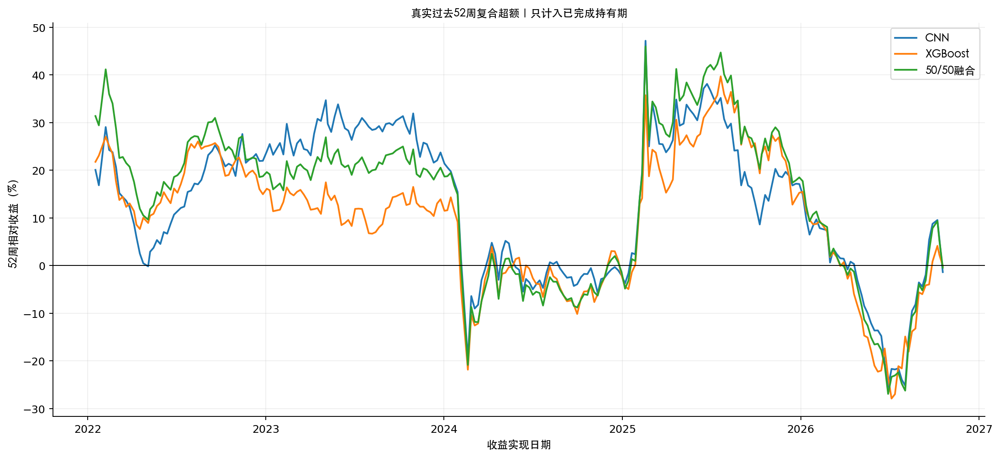

**读图**：纵轴零线以上代表截至当时已经实现的过去约52周跑赢指数；大幅跳升不必然代表当周模型突然变强，要检查窗口移出的旧收益。2024-01-26信号对应2024-01-29至02-05持有，融合净收益约−20.58%、指数约−10.02%；2024-02-02信号对应02-05至02-19，融合净收益约−6.64%、指数约+15.40%。这些巨大相对亏损后来依次滚出窗口，推动2025初曲线陡升。

---

## 12. 四档单边换手上限：10%、15%、20%、30%

原始Top200每周全额回到等权，平均单边换手约72.98%，费用与实盘容量压力过高。于是**冻结同一模型预测**，仅改变交易执行：每周仍得到当期预测Top200目标名单；但旧仓位先随上周收益漂移，卖出已掉出Top200且模型排名较弱的旧股票，再买入新进目标股票，累计卖出资金比例将超过上限时就跳过这只。新股票承接卖出旧股票相同的当前权重；保留旧股票不强制回到0.5%，组合始终200只。这意味着“Top200”成为目标名单，实际仓位可能长期包含上周甚至更早的旧持股。

第一次从空仓买满100%**豁免换手上限**。之后买卖金额相等，即 $B_t=S_t=$已执行替换金额；程序的单边换手就是该替换金额。首次建仓程序记为100%单边换手，因此“平均单边20.22%”虽然高于20%上限，但正式后续调仓均不超限。这里的首仓换手定义与无上限版 $(B+S)/2$ 的首仓50%约定有差别，比较时需看首仓特例。费用仍按买入5bp、卖出15bp计算。

| 上限 | 融合年化净收益 | 几何年化超额 | 最大回撤 | 平均单边周换手 | 周费用率之和 | 当期目标Top200平均覆盖权重 |
|---:|---:|---:|---:|---:|---:|---:|
| 10% | 17.38% | 16.84% | −27.58% | 10.26% | 5.90% | 28.47% |
| 15% | 18.38% | 17.83% | −26.81% | 15.24% | 8.84% | 37.15% |
| 20% | 18.97% | 18.42% | −28.34% | 20.22% | 11.78% | 44.52% |
| 30% | 17.67% | 17.13% | −30.44% | 30.18% | 17.66% | 57.07% |

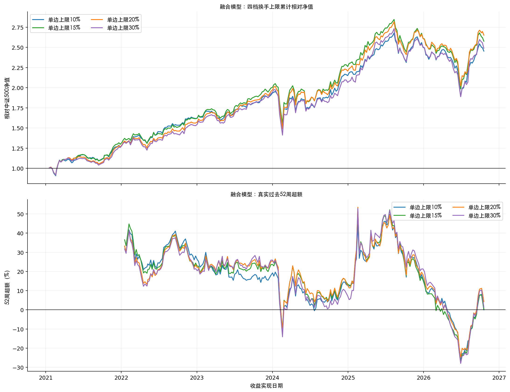

**读图**：此图比较相同冻结预测下四种**执行路径**。20%历史数值最高不意味着20%是经过独立验证的最优值：我们已经看过同一测试期四档结果，若据此挑赢家，再把同段说成严格样本外就会产生二次调参偏差。限制越紧也不总是更稳，因为持仓离最新目标越远；10%档当期目标名单只有约28.47%平均仓位。

---

## 13. 最新实验：Top100目标名单，单边周换手上限20%

这次只改变上一节20%版本的**目标名单数量**：由每周预测前200改为预测前100。仍是同一六轮CNN/XGBoost、同一固定50/50融合、同一295期全局周历、同一股票池和官方指数开盘口径、同一买5bp/卖15bp；不额外做Barra行业或风格优化，也没有单票上限。首次从空仓持有100只、每只1%；以后优先把排名弱且掉出新Top100的旧仓换为新进Top100，实际卖出比例≤20%，保留仓位不重新等权。实际持仓始终100只，但**不保证这100只都是本周最高分，也不保证每只仍1%**。

| 组合 | 年化净收益 | 几何年化超额 | 最大回撤 | 平均单边换手 | 周费用率之和 | 当期目标覆盖权重 |
|---|---:|---:|---:|---:|---:|---:|
| Top100＋20% | **21.05%** | **20.48%** | −31.78% | 20.15% | 11.74% | 40.36% |
| Top200＋20% | 18.97% | 18.42% | −28.34% | 20.22% | 11.78% | 44.52% |

| 收益实现年度 | Top100净收益 | Top200净收益 | Top100对指数复合相对收益 | Top200对指数复合相对收益 |
|---|---:|---:|---:|---:|
| 2021 | 45.10% | 40.15% | 30.89% | 26.42% |
| 2022 | −4.14% | −1.99% | 20.78% | 23.49% |
| 2023 | 12.24% | 15.07% | 22.14% | 25.22% |
| 2024 | 31.27% | 25.34% | 18.14% | 12.81% |
| 2025 | 52.32% | 50.01% | 20.15% | 18.33% |
| 2026至10月 | −3.59% | −8.36% | 6.89% | 1.60% |

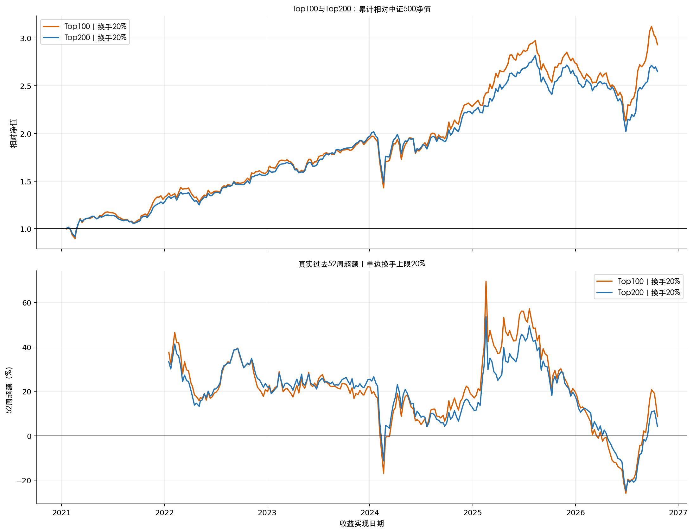

**读图**：比较前先确认纵轴是累计复合相对净值还是过去52周超额，二者不能混为一谈。Top100这段历史总体更高，但回撤−31.78%比Top200的−28.34%更深，平均只有40.36%仓位仍在当期最新Top100，曾出现**14.51%单票权重**（平均各周最大单票3.88%）；这是“保留旧仓且不再平衡”在限换手下的集中度风险。2026年仅到10月。

### 13.1 换手与费用再举一个完整例子

假设本周调仓前持有100只，其中一只原来买入时权重1%，上周上涨后漂移成1.3%，而它已不在最新Top100。程序要卖掉它时，记 **1.3%卖出金额**，新股票接收1.3%买入权重，不能按旧1%计算。若本周此前已替换19.5%，再卖这只将使总替换20.8%，超过20%上限，程序会跳过它；因此它继续留在实际仓位，下周再考虑。若实际本周总替换正好20%，买卖费用率是 $0.0005\times0.20+0.0015\times0.20=0.0004=0.04\%$，即该周组合净收益从毛收益减0.04个百分点。首周从空仓买满100%，只有买费0.05%，且不受20%上限约束。

---

## 14. 所有指标的统一读法，以及哪些结论暂不能说

设 $r_t^{\mathrm{net}}$ 为策略净收益、$r_t^{\mathrm{idx}}$ 为指数同期收益。从共同起点1开始，**策略绝对净值**、**指数净值**和**累计复合相对收益**分别为：

$$
P_t=\prod_{u=1}^{t}(1+r_u^{\mathrm{net}}),
\qquad
I_t=\prod_{u=1}^{t}(1+r_u^{\mathrm{idx}}),
\qquad
E_t=\frac{P_t}{I_t}-1.
$$

例如策略净值1.30、指数1.10，相对收益是18.18%，不是简单相减所得20个百分点。设整体实际持有天数为 $D$，年化净收益和几何年化超额分别为：

$$
R_{\mathrm{ann}}=P_T^{365.25/D}-1,
\qquad
E_{\mathrm{ann}}=\left(\frac{P_T}{I_T}\right)^{365.25/D}-1.
$$

年度相对收益若只覆盖一部分年度不可强行说是全年。最大回撤定义为：

$$
\operatorname{MDD}=\min_t\left(\frac{P_t}{\max_{s\le t}P_s}-1\right).
$$

它衡量历史峰值后的最大损失，不是“单周最大亏损”。

**Rank IC** 衡量全股票池的排序，**Top200相对全市场等权池的毛收益优势**衡量最前端是否真有更高收益；**相对CSI500净超额**还受行业/市值差异、权重和交易费用影响。因此不能用一个正IC自动推出稳健多头超额。多空端即使漂亮，也可能依赖不可实际融券的股票，不能替代多头实盘证据。

必须保留的四个限制：①XGBoost的96个候选来自2021—2025历史表现筛出的354名单，融合结果**不是严格无偏样本外**；②10/15/20/30档与Top100是观察测试期结果后做的敏感性实验，比较赢家也不能当新独立测试；③最新费用只是5/15bp固定简化费率，缺订单簿成交、冲击、借券等；④早期版本有跨年重复周、未来价格过滤、成交后风险越界或先看下一开盘可交易状态等问题，已知旧图只作为研究过程记录。

真正需要进一步验证的是：**在未参与354候选筛选、未参与换手/Top数量比较的新时期**，先冻结候选生成方法、模型、持仓数、上限和费用，再前瞻运行；同时增加交易可达性、单票上限和容量约束。当前已经能诚实得出的结论是：完整Alpha360 CNN与非Alpha360 XGBoost在历史股票排序上都显示信息，固定50/50融合在修复后的同口径回测优于两个单通道；Top100＋20%在这段历史里较Top200＋20%获得更高收益，同时更集中且仍有显著候选前视与执行模拟限制。

---

## 15. 对照文件与复核入口

- [最新Top100逐周回测](../results/top100_weekly.csv)：每周信号、入场、实现日、毛净收益、买卖金额、费用、换手、持仓等。
- [Top100绩效汇总](../results/top100_performance.csv) 与 [Top100/Top200对照](../results/top100_vs_top200.csv)。
- [真实52周超额明细](../results/top100_52w.csv) 与 [四档换手绩效](../results/turnover_caps_performance.csv)。
- [全局周历及真实权重费用实现](../code/fix_global_weekly_calendar_backtest.py)、[换手上限实现](../code/run_turnover_cap_sensitivity.py)、[Top100实验实现](../code/run_top100_turnover20.py)。
- 这些代码是原研究工程快照；因原始行情、模型预测、研究员文件及大量中间数据未进入公开仓库，不能仅凭本仓库从零重训。原始数据和成果的公开授权需由拥有者确认。
